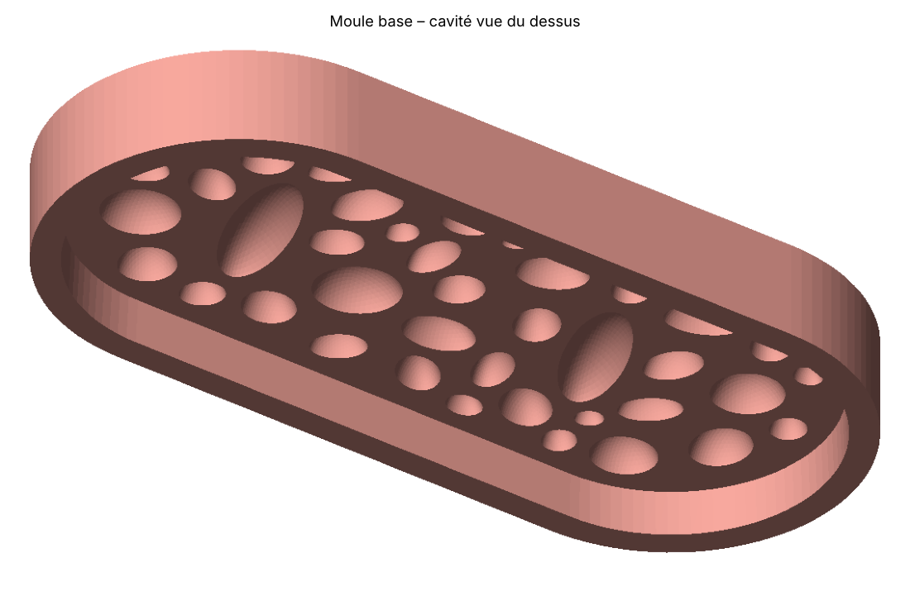
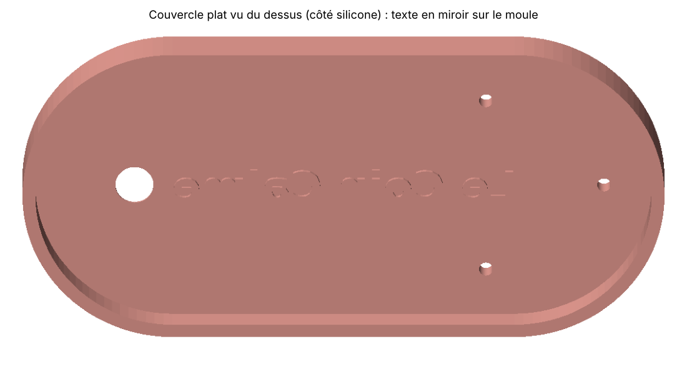
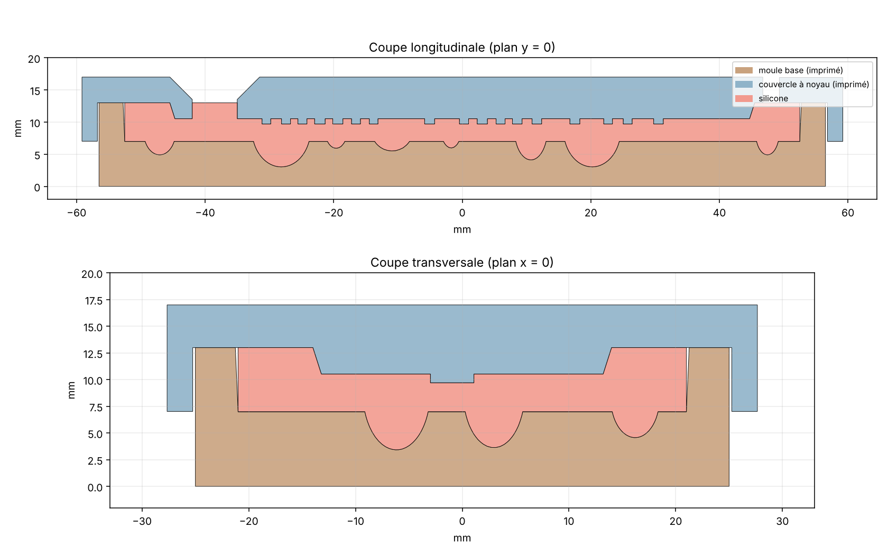
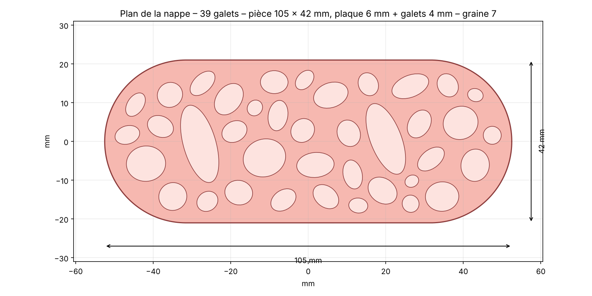

# Moule « galets » – Le Coin Calme

Moule imprimable en 3D pour couler le coussin tactile en silicone (plaque en forme de
pilule avec galets en relief, dos plat). Conçu pour **remplir toutes les cavités sans
bulle** et **réduire la quantité de silicone** par pièce.



## 1. Fichiers

| Fichier | Rôle | À imprimer ? |
|---|---|---|
| `stl/moule_base.stl` | Moule ouvert 1 pièce : cavité de la plaque + empreintes des 39 galets | **Oui** |
| `stl/moule_couvercle_plat.stl` | Couvercle à jupe auto-centrante, trou de coulée avec entonnoir, 3 évents, nom « Le Coin Calme » en miroir. Donne un dos plat marqué et une épaisseur constante | Optionnel (recommandé) |
| `stl/moule_couvercle_noyau.stl` | Même couvercle + noyau qui évide le dos de 2,5 mm (~22 % de silicone en moins que le moule ouvert), nom en miroir sur le noyau | Optionnel |
| `stl/piece_reference.stl` | La pièce en silicone attendue, pour vérification visuelle | Non |
| `generer_moule.py` | Générateur paramétrique (toutes les cotes modifiables en tête de fichier) | – |
| `apercu/*.png` | Plan de la nappe, rendus 3D, coupes du moule assemblé | – |

## 2. Hypothèses dimensionnelles (à valider au pied à coulisse)

Les cotes ont été **estimées à partir des photos** (main comme échelle). Mesurer la
pièce originale et corriger `L`, `W`, `T_BASE`, `H_GALET` dans `generer_moule.py`.

| Paramètre | Valeur | Commentaire |
|---|---|---|
| Longueur × largeur pièce | 105 × 42 mm | forme « stade » (pilule) |
| Épaisseur de la plaque | 6 mm | l'original semble faire ~8 mm : **-25 % de silicone** sans changer le toucher |
| Hauteur des galets | 4 mm max | les petits galets sont plus bas (1,4 × leur petit demi-axe) |
| Nombre de galets | 39 | disposition organique reproductible (graine 7), cloisons mini 1,8 mm |
| Plancher sous les galets | 3 mm | rigidité du moule |
| Parois du moule | 4 mm | |
| Dépouille de la cavité | 0,3 mm/côté | aide au démoulage |
| Jeu jupe/moule | 0,25 mm/côté | ajuster si le couvercle est trop serré ou flottant |

La nappe de galets est **une réinterprétation** de l'original (impossible de la copier
exactement depuis des photos). Pour une autre disposition : changer `GRAINE` et relancer.

## 3. Bilan silicone par pièce (densité 1,10 g/cm³)

| Configuration | Volume | Masse |
|---|---|---|
| Original estimé (plaque 8 mm) | 35,5 cm³ | ≈ 39 g |
| Nouveau moule ouvert (plaque 6 mm) | 27,4 cm³ | ≈ 30 g (**-23 %**) |
| Nouveau moule + couvercle à noyau | 21,5 cm³ | ≈ 24 g (**-39 %**) |

Mélanger ~10 % de plus que le volume théorique (pertes dans le gobelet et l'entonnoir).

## 4. Impression

* **Orientation** : moule base cavité vers le haut (telle quelle). Couvercles face
  extérieure sur le plateau, jupe vers le haut. L'entonnoir est à 45°, aucun support.
* **Matériau** : PLA ou PETG (compatibles silicone platine). Résine SLA = meilleure
  surface mais **inhibe la réticulation du silicone platine** (voir §6).
* **Hauteur de couche** : 0,12 mm (ou 0,08 mm) pour limiter l'escalier dans les
  cuvettes des galets, ce qui facilite le remplissage et le démoulage.
* **Périmètres** : 4, remplissage 25 % et plus. Dessus/dessous : 5 couches.
* Pas de brim nécessaire ; vérifier la planéité du bord supérieur du moule base
  (il fait joint avec le couvercle).
* Après impression : poncer légèrement le bord supérieur, souffler les cuvettes.
  Pour une surface vitrée : 2 couches fines de vernis acrylique ou de résine époxy
  (XTC-3D) dans la cavité.

## 5. Procédure de coulée

### 5.1 Préparation (commune)
1. Démoulant (spray type Ease Release 200 ou un voile de vaseline très fin) dans
   toute la cavité, **en insistant dans les cuvettes des galets**.
2. Préchauffer le moule à 30–35 °C (sèche-cheveux 1 min) : baisse la viscosité du
   silicone, améliore le mouillage des parois.
3. Peser les composants A/B sur la balance (ratio exact), mélanger 3 min en raclant
   les bords, puis dégazer sous vide si possible (sinon : mélange lent + repos 2 min).

### 5.2 Moule ouvert (le plus simple)
4. **Couche d'accroche** : avec un petit pinceau plat, badigeonner le fond des cuvettes
   de galets avec une mince couche de silicone. C'est l'étape qui élimine les bulles
   et les galets « à trou ».
5. Couler le reste en **filet mince et continu, depuis haut (30 cm)**, toujours au même
   point : le filet s'étire et éclate les bulles. Laisser le silicone s'étaler seul.
6. Remplir **à ras bord**, puis araser avec une spatule rigide (carte plastique)
   en un seul passage : épaisseur exacte et dos plat sans gaspillage.
7. Tapoter le moule 30 s sur la table pour faire remonter les bulles résiduelles.

### 5.3 Moule fermé (couvercle plat ou à noyau)
4. Couche d'accroche dans les cuvettes (comme ci-dessus).
5. Remplir le moule base à environ 2 mm du bord.
6. Poser le couvercle (la jupe le centre), presser : l'excédent sort par les évents.
7. Compléter par l'entonnoir de coulée jusqu'à ce que le silicone affleure aux
   3 évents. Maintenir avec 2 pinces à ressort pendant la prise.
8. Après démoulage, couper les carottes des évents et de la coulée au ras du dos.

### 5.4 Démoulage
* Respecter le temps de démoulage du fabricant (+ 25 % si pièce à température
  ambiante < 20 °C).
* Décoller un bord avec une spatule plastique, puis **peler** la pièce en la pliant :
  les galets se démoulent sans effort grâce aux flancs rentrants.
* Nettoyer le moule à l'alcool isopropylique entre deux coulées.

## 6. Points de vigilance (pro)

* **Inhibition de cure** : le silicone platine (Dragon Skin, Ecoflex, Smooth-Sil…)
  reste collant au contact de résine SLA mal post-polymérisée, de latex, de soufre,
  de certains PLA « soft ». Tester avec une goutte sur une chute imprimée avant une
  série. Le silicone étain (condensation) n'a pas ce problème.
* **Bulles dans les galets** : viennent toujours d'un remplissage « en masse ».
  La couche d'accroche au pinceau (§5.2 étape 4) règle 95 % des cas.
* **Dos bombé** : coulée trop haute dans le moule ouvert sans arasage. Araser ou
  passer au couvercle.
* **Couvercle trop serré / trop lâche** : ajuster `JEU_JUPE` (±0,1 mm) et relancer.
* **Usure du moule** : prévoir 1 moule imprimé pour ~30 à 50 coulées en PLA ; en PETG
  davantage. Garder le fichier pour réimprimer.

## 7. Marquage « Le Coin Calme »

Le nom est intégré **en miroir sur le moule** (principe du tampon) pour être lisible
à l'endroit sur la pièce démoulée. Lettres en relief de 0,8 mm sur le moule, donc
**gravées de 0,8 mm dans le silicone** : aucune bulle possible dans les lettres,
contrairement à des lettres creusées dans le moule.

| Où | Réglage | Résultat sur la pièce |
|---|---|---|
| Couvercle plat et couvercle à noyau (par défaut) | `TEXTE_SUR_COUVERCLE = True` | Nom gravé au centre du dos plat, lisible |
| Moule ouvert, face galets (option) | `TEXTE_FACE_GALETS = True` | Bande sans galet au centre avec le nom gravé entre les galets (32 galets au lieu de 39) |

Police DejaVu Sans Bold (fournie avec matplotlib), taille `TAILLE_TEXTE = 8` (capitales
≈ 6 mm, traits ≈ 1,1 mm, compatible buse 0,4 mm). Le texte lui-même se change avec
`TEXTE`. Aperçu de contrôle : `apercu/couvercle_plat_dessus.png` doit montrer le texte
**inversé** ; s'il se lit à l'endroit sur le moule, il sera inversé sur la pièce.



## 8. Régénérer les fichiers

```bash
pip install manifold3d trimesh numpy matplotlib
python3 generer_moule.py
```

Le script affiche le bilan silicone, vérifie que les maillages sont étanches
(watertight) et régénère les STL et les aperçus.



